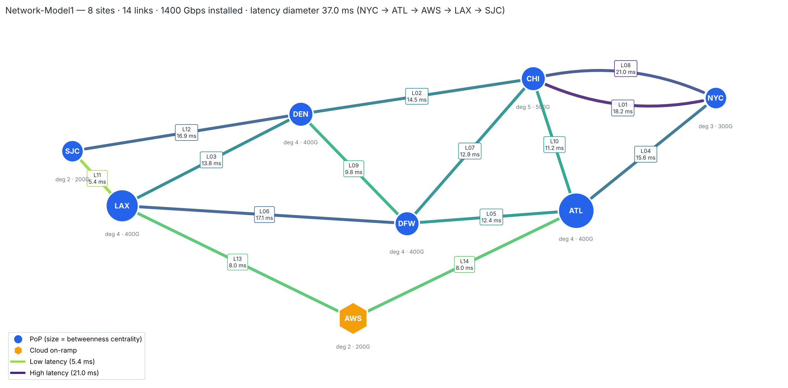
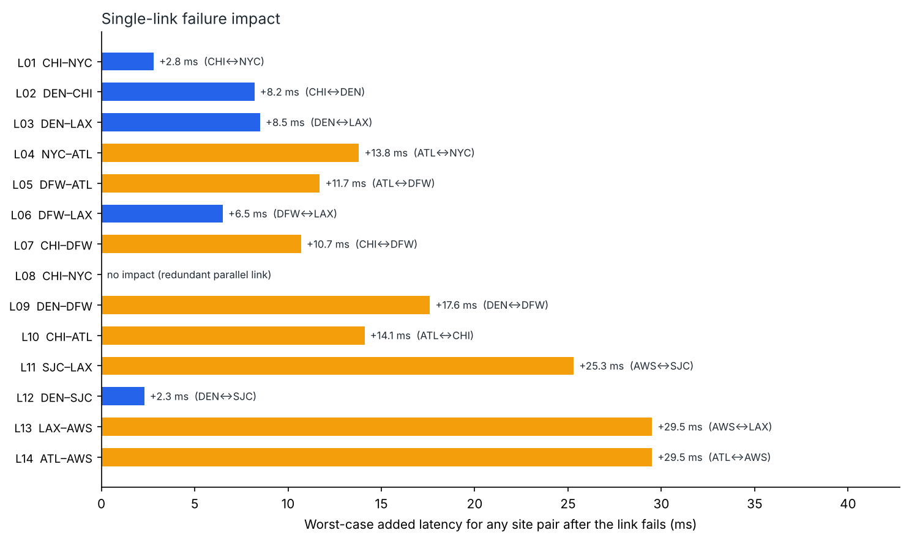

# Model 1 — Backbone Topology & Resilience

A NetworkX model of an 8-site, 14-link U.S. backbone with a cloud on-ramp. The program reads the link table, builds a graph, runs path and resilience analysis, and renders a topology map.



## The network

| Link | A-End | Z-End | Capacity (Gbps) | Latency (ms) |
|------|-------|-------|----------------:|-------------:|
| L01 | NYC | CHI | 100 | 18.2 |
| L02 | CHI | DEN | 100 | 14.5 |
| L03 | DEN | LAX | 100 | 13.8 |
| L04 | NYC | ATL | 100 | 15.6 |
| L05 | ATL | DFW | 100 | 12.4 |
| L06 | DFW | LAX | 100 | 17.1 |
| L07 | CHI | DFW | 100 | 12.9 |
| L08 | NYC | CHI | 100 | 21.0 |
| L09 | DEN | DFW | 100 | 9.8 |
| L10 | CHI | ATL | 100 | 11.2 |
| L11 | LAX | SJC | 100 | 5.4 |
| L12 | DEN | SJC | 100 | 16.9 |
| L13 | LAX | AWS | 100 | 8.0 |
| L14 | ATL | AWS | 100 | 8.0 |

**Sites:** NYC, CHI, ATL, DFW, DEN, LAX, SJC (PoPs) and AWS (cloud on-ramp)
**Total installed capacity:** 1,400 Gbps

## How it is modeled

- **`nx.MultiGraph`** holds the physical topology, so the two NYC–CHI circuits (L01, L08) stay as separate edges with their own attributes.
- **A collapsed `nx.Graph`** is used for path math. Parallel links merge into one adjacency, keeping the lowest latency and summing the capacity. Edge-connectivity is also measured on this graph, which treats parallel circuits between the same two sites as one shared risk.
- **Latency (ms)** is the routing weight for Dijkstra shortest paths, betweenness and closeness.

## Analyses

| Analysis | NetworkX functions |
|---|---|
| All-pairs lowest-latency matrix and paths | `all_pairs_dijkstra_path_length`, `dijkstra_path` |
| Latency diameter and average path latency | `average_shortest_path_length` |
| Site importance | `betweenness_centrality`, `closeness_centrality` |
| Structural SPOFs | `articulation_points`, `bridges` |
| Network-wide and per-pair redundancy | `edge_connectivity`, `node_connectivity` |
| Single-link failure | removes each link and re-runs all-pairs paths |
| Single-site failure | removes each site and checks `connected_components` |

## Key findings

- **No single point of failure.** There are no bridges and no articulation points. Edge and node connectivity are both 2, so the network survives the loss of any one link or any one site.
- **Latency diameter is 37.0 ms**, on the path NYC → ATL → AWS → LAX → SJC. Average lowest-latency path is 19.0 ms.
- **AWS is carrying transit traffic.** L13 and L14 are both 8.0 ms, so several west↔east lowest-latency paths route through the cloud on-ramp (LAX↔ATL, LAX↔NYC, CHI↔LAX). In practice this would be prevented with routing policy, or the AWS latencies are placeholders worth revisiting.
- **ATL has the highest betweenness (0.333)**, followed by AWS and LAX (0.238). Together they form the southern east–west spine.
- **The most damaging single-link failures** are L13 AWS–LAX and L14 AWS–ATL (+29.5 ms worst case) and L11 LAX–SJC (+25.3 ms, pushing the diameter to 49.6 ms).
- **L08 NYC–CHI has zero latency impact** when it fails, because L01 is the faster circuit on the same pair.
- **NYC and SJC are the thinnest sites.** Two link failures can isolate either one from the rest of the network.



The full output, including the complete latency matrix and every pairwise path, is in [`output/network_report.txt`](output/network_report.txt).

## Run it

```bash
pip install -r ../requirements.txt
python network_model.py                     # reads data/Network-Model1.numbers, writes to output/
python network_model.py data/links.csv      # same model from the CSV export
python network_model.py my_links.csv --outdir /tmp/run1
```

The input needs a header row with these columns: `Link ID`, `A-End`, `Z-End`, `Capacity (Gbps)`, `Latency (ms)`. The header can sit anywhere in the sheet; blank rows are skipped.

Map positions for known sites are set in `SITE_POS` at the top of the script. Sites not listed there still appear, placed with an automatic spring layout.

## Files

```
model1/
├── network_model.py           # the model and analysis program
├── data/
│   ├── Network-Model1.numbers # source link table (Apple Numbers)
│   └── links.csv              # same table as CSV
└── output/
    ├── network_topology.png   # topology map
    ├── network_resilience.png # single-link failure impact
    └── network_report.txt     # full text report
```

## Limits of this model

- Latency-only routing. There is no traffic matrix, so the model does not show link utilization or congestion after a failure.
- Single failures only. It does not model shared-risk link groups or dual failures.
- All links are 100G and treated as equal-cost apart from latency. There are no IGP metrics, ECMP or TE constraints.

These are the starting points for the next models in this repo.
