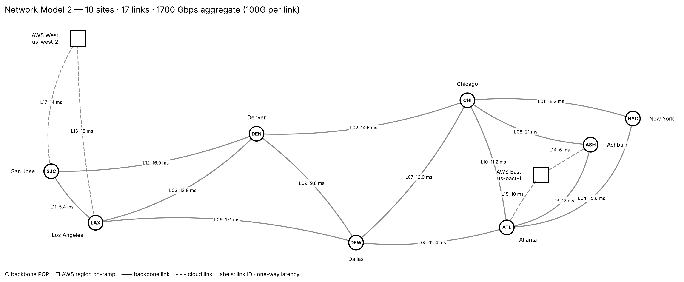
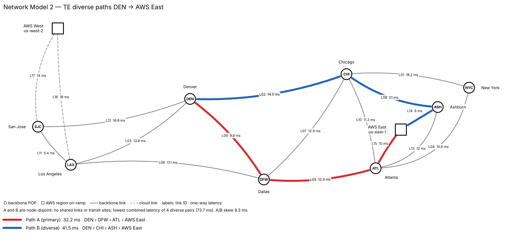

# Model 2 — Dual AWS Regions, Failure Analysis & TE Paths

A NetworkX model of a 10-site, 17-link U.S. backbone with two AWS region on-ramps. It builds on [model1](../model1/) by adding an Ashburn PoP, splitting AWS into East and West regions, sweeping every single and double failure, and computing traffic-engineered diverse A/B paths.



## The network

| Link | A-End | Z-End | Capacity (Gbps) | Latency (ms) |
|------|-------|-------|----------------:|-------------:|
| L01 | NYC | CHI | 100 | 18.2 |
| L02 | CHI | DEN | 100 | 14.5 |
| L03 | DEN | LAX | 100 | 13.8 |
| L04 | NYC | ATL | 100 | 15.6 |
| L05 | ATL | DFW | 100 | 12.4 |
| L06 | DFW | LAX | 100 | 17.1 |
| L07 | CHI | DFW | 100 | 12.9 |
| L08 | CHI | ASH | 100 | 21.0 |
| L09 | DEN | DFW | 100 | 9.8 |
| L10 | CHI | ATL | 100 | 11.2 |
| L11 | LAX | SJC | 100 | 5.4 |
| L12 | DEN | SJC | 100 | 16.9 |
| L13 | ASH | ATL | 100 | 12.0 |
| L14 | ASH | AWS East | 100 | 6.0 |
| L15 | ATL | AWS East | 100 | 10.0 |
| L16 | LAX | AWS West | 100 | 18.0 |
| L17 | SJC | AWS West | 100 | 14.0 |

**Sites:** NYC, ASH, ATL, CHI, DFW, DEN, LAX, SJC (PoPs), AWS East and AWS West (cloud regions)
**Total installed capacity:** 1,700 Gbps

### Changes from model1

| | Model 1 | Model 2 |
|---|---|---|
| Sites | 7 PoPs + one `AWS` node | 8 PoPs (adds **ASH**) + **AWS East** and **AWS West** |
| Links | 14, including two NYC–CHI circuits | 17, no parallel circuits |
| Cloud attach | LAX and ATL to a single AWS node | ASH + ATL to AWS East; LAX + SJC to AWS West |
| East coast | NYC–CHI ×2 | CHI–ASH and ASH–ATL add an Ashburn path |

Splitting AWS into two regions removes model1's issue of AWS carrying west↔east transit traffic.

## Programs

| Program | What it does | Outputs |
|---|---|---|
| `network_model2.py` | Builds the graph, runs path and resilience analysis, renders the topology map | `network_model2.png/.svg`, `analysis.txt` |
| `analyze_model2.py` | Latency matrix, single and double link failures, site failures, cloud reachability | `failure_analysis.txt` |
| `te_paths.py` | Lowest-latency pair of fully diverse A/B paths between any two sites | `te_<src>_<dst>.png/.svg/.txt` |

## How it is modeled

- **`nx.MultiGraph`** holds the physical topology. A collapsed **`nx.Graph`** is used for path math, the same approach as model1.
- **Latency (ms)** is the routing weight for Dijkstra paths and betweenness.
- **Sites are placed at real latitude/longitude.** AWS West sits at us-west-2 (Oregon). AWS East represents us-east-1 and is drawn southwest of Ashburn so both of its links stay visible.
- **Curved links.** For each link the renderer scores a range of arc bends and keeps the one that stays clear of other sites, links and labels while staying close to the straight geographic path.
- **Diverse paths are exact.** `te_paths.py` enumerates every simple path, keeps the pairs that share no links and no transit sites, and picks the pair with the lowest combined latency (the Suurballe objective).

## Analyses

| Analysis | NetworkX functions |
|---|---|
| All-pairs lowest-latency matrix, diameter, best-path load per link | `all_pairs_dijkstra_path_length`, `dijkstra_path` |
| Structural SPOFs and redundancy | `bridges`, `articulation_points`, `edge_connectivity` |
| Single-link and double-link failure | removes every link and every link pair, then checks `connected_components` |
| Single-site and double-site failure | removes every site and site pair |
| Cloud reachability under failure | `dijkstra_path_length`, `has_path` to each AWS region |
| Diverse A/B path selection | `all_simple_paths`, `path_weight` |

## Key findings

### Latency
- **Latency diameter is 63.1 ms**, from AWS West to NYC (AWS West › LAX › DFW › ATL › NYC). Average site-to-site latency is 27.8 ms.
- **Every direct link is the fastest route between its own two ends**, so no link is redundant from a routing view.
- **The southern spine carries most traffic.** L05 ATL–DFW is on the best path for 18 of 45 site pairs and L06 DFW–LAX for 14. West↔east traffic prefers ATL › DFW › LAX over CHI–DEN.

### Failures that isolate sites
- **No single point of failure.** No single link or site outage isolates anything. Edge connectivity is 2.
- **The worst single-link cuts** add latency rather than isolating sites: L11 LAX–SJC (+25.3 ms), L09 DEN–DFW (+17.6 ms) and L14 ASH–AWS East (+16.0 ms).
- **Only 3 of 136 double-link cuts split the network**, and each isolates a site that has only two links:

  | Links lost | Site isolated |
  |---|---|
  | L01 + L04 | NYC |
  | L14 + L15 | AWS East |
  | L16 + L17 | AWS West |

- **Six double-site outages strand surviving sites.** The worst is CHI + DFW, which splits the network east/west and cuts off ASH, ATL, AWS East and NYC. ATL + CHI strands ASH, AWS East and NYC.
- **ATL is the busiest transit site** (latency-weighted betweenness 0.44), followed by DFW (0.39). Losing ATL adds 19.6 ms between AWS East and NYC.

### TE diverse paths: DEN → AWS East



| Path | Latency | Route | Links |
|---|---|---|---|
| A (red) | 32.2 ms | DEN › DFW › ATL › AWS East | L09 L05 L15 |
| B (blue) | 41.5 ms | DEN › CHI › ASH › AWS East | L02 L08 L14 |

- **A and B share no links and no transit sites.** Of the 4 node-disjoint pairs, this one has the lowest combined latency (73.7 ms, against 94.8 ms for the next best).
- **A is the IGP shortest path**, so protecting the route costs no latency on the primary.
- **No single link or site failure takes down both paths.**
- **A/B skew is 9.3 ms.** That is the latency step on failover from A to B, and the buffer needed for 1+1 hitless protection.
- **The topology fixes B.** AWS East is reachable only through ASH and ATL, and ASH connects only to CHI and ATL. Any path diverse from A must therefore run DEN › CHI › ASH.

### Recommendations
- **Give NYC a third link**, for example NYC–ASH. That removes one of the three isolating double cuts and stops an ATL + CHI outage from stranding NYC.
- **Add an east–west route that bypasses ATL and DFW**, such as ASH–DEN or ASH–DFW. ATL and DFW appear in four of the six damaging double-site outages.
- **Check physical diversity of each AWS on-ramp pair.** If L14/L15 or L16/L17 share conduit, one fiber cut could isolate a region. The link table has no SRLG data, so this needs checking against circuit records.

Full output: [`output/analysis.txt`](output/analysis.txt), [`output/failure_analysis.txt`](output/failure_analysis.txt), [`output/te_DEN_AWSEast.txt`](output/te_DEN_AWSEast.txt).

## Run

From the repo root:

```bash
python model2/network_model2.py      # topology map + analysis.txt
python model2/analyze_model2.py      # latency and failure sweep
python model2/te_paths.py            # DEN -> AWS East A/B paths
python model2/te_paths.py NYC "AWS West"              # any site pair
python model2/te_paths.py DEN "AWS East" --link-disjoint
```

All three read `data/Network-Model2.numbers` by default. Pass `data/links.csv` to `network_model2.py` or `analyze_model2.py`, or `--source data/links.csv` to `te_paths.py`, to use the CSV instead.

## Drawing conventions

- Black-outline, unfilled nodes (○ PoP, □ AWS region), gray links, black text.
- Dashed lines are cloud on-ramp links. Labels show link ID and one-way latency.
- TE paths overlay the map in red (A) and blue (B).
- New sites need an entry in `SITES` (lat, lon, label) and `LABEL_SIDE` in `network_model2.py`.
